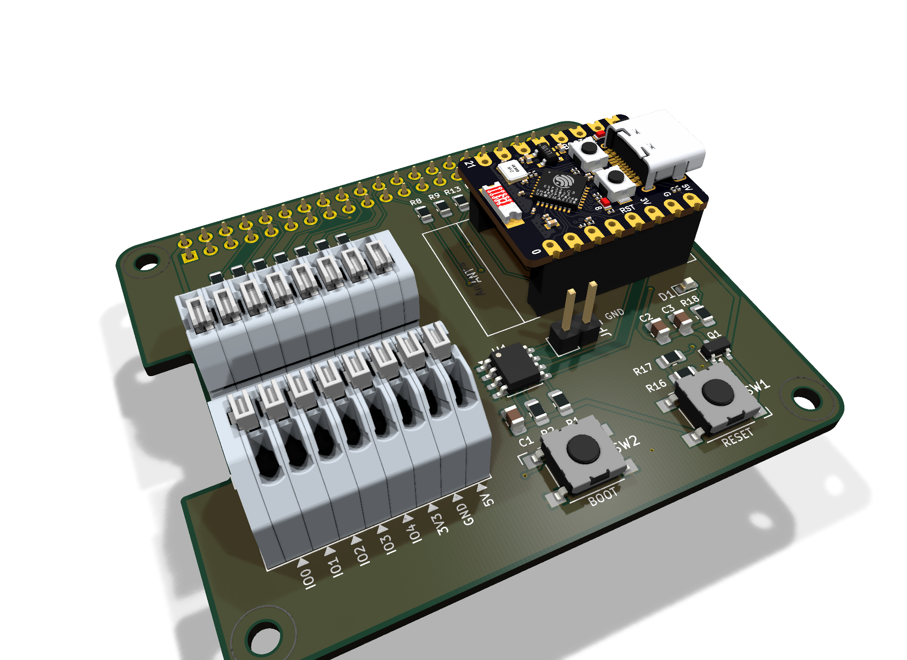
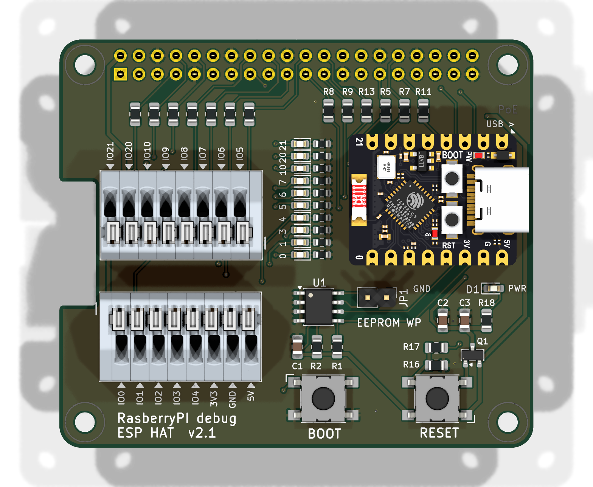

# Raspberry Pi debug ESP HAT

HAT для Raspberry Pi (40-pin), на который ставится плата **ESP32-C3 SuperMini**.
Raspberry Pi может прошивать и отлаживать ESP через UART, управлять её питанием
и режимом загрузки, а все выводы ESP выведены на пружинные клеммники для
подключения внешних проводов.



<p align="center"></p>

Проект сделан в **KiCad 10**.

## Возможности

- **Колодка для ESP32-C3 SuperMini.** Два гнезда PLS 1×8 (J4, J5). Модуль с
  впаянными штырями вставляется сверху, его можно снять.
- **Связь с Raspberry Pi.** UART0 Pi ↔ UART ESP, SPI0, несколько GPIO.
  Все линии идут через последовательные резисторы 1 кОм: это защищает от
  конфликта выходов и ограничивает обратное питание ESP, когда она выключена.
- **Управление питанием ESP.** P-MOSFET AO3401A (Q1):
  - по умолчанию питание включено (R16 тянет затвор к земле);
  - GPIO22 = HIGH выключает ESP;
  - SW1 (RESET) — ручной перезапуск по питанию (у C3 SuperMini нет вывода EN).
- **Режим загрузки.** Кнопка BOOT (SW2) на IO9, либо GPIO4 с Pi.
- **Клеммники J2, J3.** KF250-2.54-8P, все выводы ESP выведены на них для внешних
  проводов. Подписи пинов есть на обеих сторонах платы.
- **Светодиоды активности GPIO.** D2–D11, по одному на линии IO0, IO1, IO3–IO7,
  IO10, IO20, IO21. Стоят столбиком между клеммниками и ESP, у каждого подпись
  с номером IO. Цепочка: линия → светодиод → резистор → GND. Красные 0603 с 3 кОм
  (около 0.4 мА), на UART (IO20, IO21) синие с 470 Ом. На strap-пинах IO2, IO8,
  IO9 светодиодов нет, чтобы не мешать загрузке ESP.
- **HAT ID EEPROM.** CAT24C256 (U1) на ID_SD/ID_SC. Перемычка JP1 включает
  защиту от записи.
- **Индикатор питания.** Светодиод D1.

## Распиновка

### ESP → Raspberry Pi (через 1 кОм)

| ESP  | Raspberry Pi            | Примечание             |
|------|-------------------------|------------------------|
| IO0  | GPIO23 (pin 16)         |                        |
| IO1  | GPIO24 (pin 18)         |                        |
| IO2  | GPIO5 (pin 29)          | strap, подтяжка на Pi  |
| IO3  | GPIO25 (pin 22)         |                        |
| IO4  | GPIO12 / PWM0 (pin 32)  |                        |
| IO5  | GPIO9 / SPI0.MISO (pin 21) |                     |
| IO6  | GPIO11 / SPI0.SCLK (pin 23) |                    |
| IO7  | GPIO10 / SPI0.MOSI (pin 19) |                    |
| IO8  | GPIO6 (pin 31)          | strap, подтяжка на Pi  |
| IO9  | GPIO4 (pin 7)           | BOOT, подтяжка на Pi   |
| IO10 | GPIO8 / SPI0.CE0 (pin 24) |                      |
| IO20 | GPIO14 / TXD0 (pin 8)   | RX ESP                 |
| IO21 | GPIO15 / RXD0 (pin 10)  | TX ESP                 |
| PWR  | GPIO22 (pin 15)         | 1 = питание ESP выкл.  |

### Клеммники

| Пин | 1   | 2   | 3   | 4   | 5   | 6    | 7    | 8    |
|-----|-----|-----|-----|-----|-----|------|------|------|
| J2 (левый ряд ESP)  | IO5 | IO6 | IO7 | IO8 | IO9 | IO10 | IO20 | IO21 |
| J3 (правый ряд ESP) | IO0 | IO1 | IO2 | IO3 | IO4 | 3V3  | GND  | 5V   |

> **5V на J3-8** — это вывод 5V самой ESP. Он **не соединён** с 5V от Raspberry Pi,
> чтобы USB ESP не запитывал Pi в обратную сторону.

## Прошивка ESP с Raspberry Pi

1. Выключить ESP: `GPIO22 = 1`.
2. Прижать IO9 к земле: `GPIO4 = 0`.
3. Включить ESP: `GPIO22 = 0`. ESP стартует в режиме загрузки.
4. Прошить:

   ```bash
   esptool.py --before no_reset --port /dev/serial0 write_flash 0x0 firmware.bin
   ```

Перед выключением ESP переведите выводы Pi, которые на неё работают, в режим
входа. Иначе ESP будет питаться через IO.

## Файлы

| Файл | Что это |
|------|---------|
| `RasberryPI debug ESP HAT.kicad_pro` / `.kicad_sch` / `.kicad_pcb` | проект KiCad |
| [`schematic.pdf`](schematic.pdf) | схема в PDF |
| [`BOM.csv`](BOM.csv) | перечень элементов |
| `ESP_Debug.pretty/` | посадочное место колодки ESP32-C3 SuperMini |
| `images/` | 3D-рендеры для README |

## Перечень элементов (кратко)

| Обозначение | Номинал | Корпус |
|-------------|---------|--------|
| U2 | ESP32-C3 SuperMini | модуль в гнёздах J4, J5 (PLS 1×8) |
| U1 | CAT24C256 | SOIC-8 |
| Q1 | AO3401A | SOT-23 |
| J1 | гнездо 2×20 для GPIO Pi | 2.54 мм |
| J2, J3 | KF250-2.54-8P (LCSC C49173293) | пружинные клеммники |
| JP1 | перемычка 1×2 | 2.54 мм |
| SW1, SW2 | тактовые кнопки | Omron B3FS-100xP |
| R3–R15, R17, R18 | 1 кОм | 0805 |
| R1, R2 | 3.9 кОм | 0805 |
| R16 | 100 кОм | 0805 |
| C1, C3 / C2 | 100 нФ / 10 мкФ | 0805 |
| D1 | светодиод | 0603 |
| D2–D9 / D10, D11 | светодиод красный TO-1608BC-MRE / синий TO-1608BC-BF | 0603 |
| R19–R26 / R27, R28 | 3 кОм / 470 Ом | 0603 |

Полный список — в [`BOM.csv`](BOM.csv).

> 3D-модели ESP32-C3 SuperMini и клеммников KF250 лежат в пользовательской
> библиотеке (`${KIKAD_USER_3DMODELS}`) и в репозиторий не входят.
